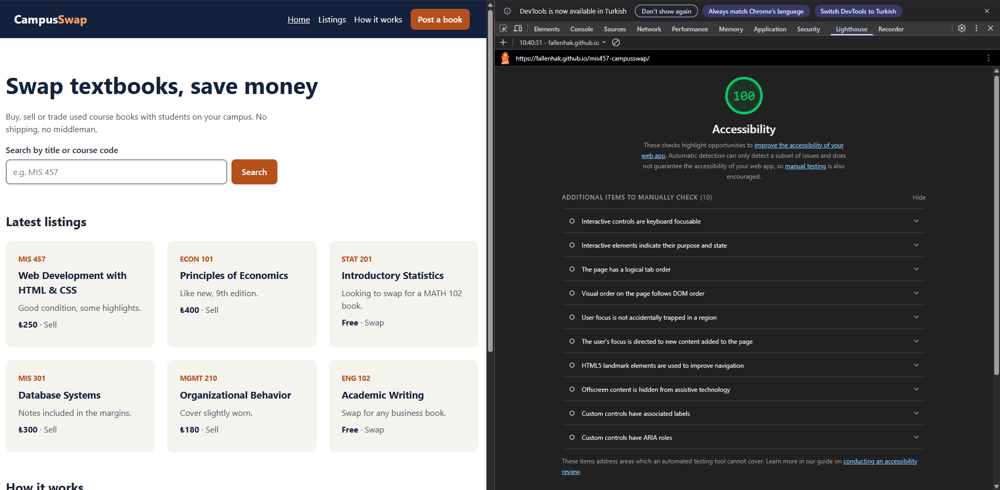

# CampusSwap

MIS 457 – Web Based Application Programming · Team Project

A platform where students buy, sell and swap used textbooks on campus.

## Team

| Name | Student ID |
|---|---|
| Kerim Burak Tuz | 240106436 |
| Yusuf Efe Akar | 240106421 |
| Ali Yusuf Bayram | 240106419 |
| Utku Kaan Yücebıyık | 240106416 |

## Week 2 – Static prototype

- `index.html` – home page (semantic HTML, Flexbox header, mobile-first card grid)
- `post.html` – "Post a book" form, every input labelled
- `style.css` – shared styles, responsive at 375px and 1280px

Live: https://fallenhak.github.io/mis457-campusswap/

## Week 3 – JavaScript and the DOM

- `app.js` – all JavaScript, loaded with `defer` on both pages
- **Dynamic list:** the listing cards on the home page are built from the `books` array with `createElement` / `append`
- **Search:** filters the array by title or course code as you type, with a live result count and an empty state
- **Validation:** the "Post a book" form uses `preventDefault()` and shows a clear error message under each invalid field (title, course code format, condition, sell/swap, price, name, email), plus a summary message at the top
- **Bonus:** a valid listing is saved to `localStorage` and appears first on the home page with a "New" badge

## Week 4 – Fetch, async/await and JSON

- `data.json` – the listings moved out of `app.js` into a JSON file
- **Fetch:** `app.js` loads `data.json` with `fetch` and `async` / `await` inside `try` / `catch`, and checks `response.ok` so a 404 or 500 is shown as an error
- **Four UI states** on the home page:
  - **Loading** – "Loading books..." while the request is waiting
  - **Success** – the cards are built from the fetched data
  - **Empty** – "No books match your search." when the search finds nothing
  - **Error** – "Something went wrong..." with the HTTP status and a "Try again" button
- **Search** still filters live by title or course code, now on the fetched data
- Listings posted from the form (`localStorage`) are still shown first

Run it with Live Server (Go Live) or the live link: `fetch` does not work when the file is opened with a double-click.

## Lighthouse

Accessibility score: **100**

