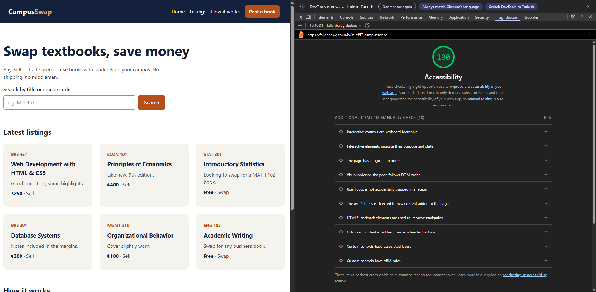

# CampusSwap

MIS 457 – Web Based Application Programming · Team Project

A platform where students buy, sell and swap used textbooks on campus.

## Team

| Name | Student ID |
|---|---|
| Kerim Burak Tuz | 240106436 |
| Yusuf Efe Akar | 240106421 |
| Ali Yusuf Bayram | 240106419 |

## Week 2 – Static prototype

- `index.html` – home page (semantic HTML, Flexbox header, mobile-first card grid)
- `post.html` – "Post a book" form, every input labelled
- `style.css` – shared styles, responsive at 375px and 1280px

Live: https://fallenhak.github.io/mis457-campusswap/

## Lighthouse

Accessibility score: **100**

